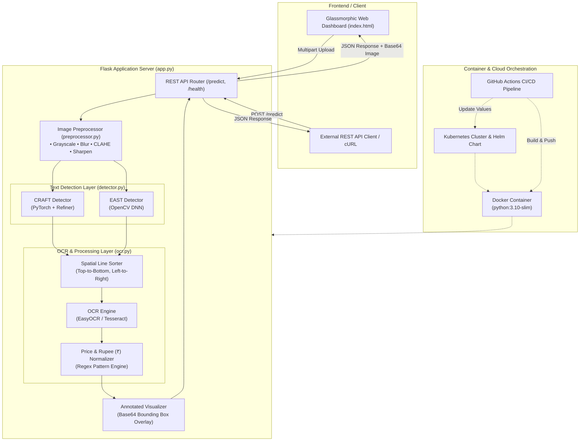

# 🚀 CRAFT + EAST OCR Extraction Hub

[](https://www.python.org/)
[](https://flask.palletsprojects.com/)
[](https://pytorch.org/)
[](https://opencv.org/)
[](https://www.docker.com/)
[](https://kubernetes.io/)
[](https://helm.sh/)
[](https://github.com/features/actions)

An enterprise-ready, end-to-end Computer Vision and Optical Character Recognition (OCR) platform designed for high-accuracy text detection and extraction from complex document scans, receipts, invoices, and natural scene images.

---

## 📑 Table of Contents

- [Key Features](#-key-features)
- [System Architecture](#-system-architecture)
- [Project Directory Structure](#-project-directory-structure)
- [Deep Learning & CV Pipelines](#-deep-learning--cv-pipelines)
  - [1. Text Detectors (CRAFT & EAST)](#1-text-detectors-craft--east)
  - [2. Image Preprocessing Suite](#2-image-preprocessing-suite)
  - [3. OCR Engine & Currency Normalizer](#3-ocr-engine--currency-normalizer)
- [Web Dashboard UI](#-web-dashboard-ui)
- [Quickstart: Local Installation](#-quickstart-local-installation)
- [Docker Deployment](#-docker-deployment)
- [Kubernetes & Helm Deployment](#-kubernetes--helm-deployment)
- [GitOps CI/CD Workflow](#-gitops-cicd-workflow)
- [REST API Reference](#-rest-api-reference)
- [Project Status & Roadmap](#-project-status--roadmap)
- [License](#-license)

---

## 🌟 Key Features

- **Dual Deep Learning Detectors:**
  - **CRAFT (Character Region Awareness for Text Detection):** Character affinity heatmaps capable of capturing arbitrary-oriented, curved, and irregular receipt/document text.
  - **EAST (Efficient and Accurate Scene Text):** OpenCV DNN pipeline using pre-trained TensorFlow weights (`frozen_east_text_detection.pb`) for rapid rotated bounding box inference.
  - **Side-by-Side Dual Detection:** Run CRAFT, EAST, or both simultaneously with color-coded bounding box overlays.
- **Adaptive Image Preprocessing Pipeline:**
  - CLAHE (Contrast Limited Adaptive Histogram Equalization) for uneven illumination.
  - Gaussian Noise Smoothing.
  - Laplacian-based edge sharpening filter.
  - Grayscale color-space conversion.
- **Natural Reading-Order Spatial Sorter:**
  - Custom line-clustering algorithm that sorts detected text regions top-to-bottom and left-to-right, preserving the document's original logical layout.
- **Multi-Engine OCR & Regex Normalization:**
  - **EasyOCR** deep learning CRNN model with CPU/CUDA auto-detection.
  - **Tesseract OCR** integration with fallback handling.
  - Regex-powered currency formatting and Indian Rupee (`₹`) recognition, fixing common OCR digit misreads (e.g. `7`/`8` prefix misidentifications).
- **Modern Glassmorphic Dark-Mode UI:**
  - Drag-and-drop image upload with real-time preview.
  - Interactive preprocessing toggles and detector engine selectors.
  - Real-time telemetry dashboard (latency, detected regions count, hardware acceleration indicator).
  - Dual viewport displaying extracted text and base64 annotated visualizations.
- **Cloud-Native & Production-Ready:**
  - Dockerized Debian-slim environment with system-level Tesseract binaries and CPU-optimized PyTorch wheels.
  - Kubernetes deployment manifests with health checks and startup probes.
  - Standardized Helm v3 chart.
  - GitHub Actions multi-arch CI/CD pipeline pushing to Docker Hub and automating Helm tag updates via GitOps.

---

## 🏛️ System Architecture



---

## 📂 Project Directory Structure

```text
Mega-project/
├── .github/
│   └── workflows/
│       └── ci.yaml                  # Automated multi-arch build & GitOps Helm tag updater
├── helm/
│   └── my-app/                      # Production Helm v3 Chart
│       ├── Chart.yaml               # Helm chart metadata
│       ├── values.yaml              # Configurable deployment values (replicas, image tags)
│       └── templates/               # Kubernetes Deployment & Service templates
├── k8s/
│   └── manifests/                   # Raw Kubernetes manifests (Deployment, Service)
├── models/
│   ├── craft_mlt_25k.pth            # Pre-trained CRAFT text detector weights (~83 MB)
│   └── craft_refiner_CTW1500.pth    # CRAFT link refiner network weights (~1.8 MB)
├── app.py                           # Flask backend, API routing, hotpatches, and lifecycle
├── detector.py                      # CRAFT & EAST deep learning detection implementations
├── ocr.py                           # EasyOCR / Tesseract wrappers, spatial sorting, regex
├── preprocessor.py                  # OpenCV image processing filters (CLAHE, blur, sharpen)
├── download_model.py                # Helper script to download the EAST model weights
├── frozen_east_text_detection.pb    # Pre-trained TensorFlow EAST model weights (~96.6 MB)
├── index.html                       # Glassmorphic dark-mode web dashboard UI
├── Dockerfile                       # Multi-stage optimized Docker build definition
├── requirements.txt                 # Pinned Python package dependencies
├── commands.txt                     # Quick command cheatsheet
├── startup-probe-patch.json         # Kubernetes startup probe patch for model warmup
├── metrics-patch.yaml               # Kubernetes metrics-server patch
├── test_img.png                     # Sample test receipt image for validation
├── PROJECT_STATUS.md                # Progress metrics & milestone status report
└── PROJECT_SUMMARY.md               # Detailed system overview and engineering summary
```

---

## 🧠 Deep Learning & CV Pipelines

### 1. Text Detectors (`detector.py`)

The platform implements two complementary state-of-the-art text detection architectures:

| Detector | Underlying Technology | Primary Strength | Bounding Box Format |
|---|---|---|---|
| **CRAFT** | PyTorch CNN + CTW1500 Refiner | Irregular, curved, arbitrary-oriented, multi-line text | 4-point polygon `[[x1,y1], [x2,y2], [x3,y3], [x4,y4]]` |
| **EAST** | OpenCV DNN (TensorFlow graph) | Ultra-fast natural scene text detection | Rotated rectangles with NMS suppression |

- **NumPy 1.24+ & TorchVision Hotpatches (`app.py`):** Pre-configured monkey-patches for `torchvision.models.vgg.model_urls` and coordinate transformations ensure full stability across modern Python environments without breaking legacy CRAFT dependencies.

### 2. Image Preprocessing Suite (`preprocessor.py`)

Raw images are enhanced before feeding into neural networks:
1. **Grayscale Conversion:** Reduces dimensionality and eliminates chrominance noise.
2. **Gaussian Smoothing:** `(3, 3)` kernel minimizes high-frequency scan artifacts without eroding delicate character strokes.
3. **CLAHE (Contrast Limited Adaptive Histogram Equalization):** Standardizes local lighting variances across crumpled receipts and degraded scans.
4. **Laplacian Sharpening:** Convolves a $3 \times 3$ high-pass kernel `[ [0, -1, 0], [-1, 5, -1], [0, -1, 0] ]` to bring out crisp edges.

### 3. OCR Engine & Currency Normalizer (`ocr.py`)

- **Spatial Line Sorting:**
  Groups bounding boxes on the same horizontal plane (based on vertical overlap $\le 50\%$ height), then sorts each line left-to-right. This prevents text scrambling across multi-column receipts.
- **Intelligent Rupee (`₹`) & Price Normalizer:**
  Automated regex cleaning transforms garbled OCR misreads into standardized currency notations:
  - `760.00` $\rightarrow$ `₹60.00` (fixes `7` misread for `₹`)
  - `?35.00` / `Rs. 35.00` $\rightarrow$ `₹35.00`
  - Eliminates typo underscores (`787_ 50` $\rightarrow$ `₹787.50`).

---

## 💻 Web Dashboard UI

The application includes a single-page interface built with **Plus Jakarta Sans** and **JetBrains Mono**:

- **Real-time Telemetry:** Instant display of inference latency, total regions detected, active model, and hardware acceleration status.
- **Dual Visualizer:** Inspect the original image overlaid with neon-green (CRAFT) or orange (EAST) bounding boxes side-by-side with formatted extracted text.
- **Dynamic Preprocessing Toggles:** Fine-tune Grayscale, Gaussian Blur, CLAHE, and Sharpening on the fly.
- **Model Switcher:** Toggle between **CRAFT**, **EAST**, or **Both** with a single click.

---

## ⚡ Quickstart: Local Installation

### Prerequisites

- **Python 3.10+**
- **Git**
- *(Optional)* [Tesseract OCR](https://github.com/tesseract-ocr/tesseract) installed and added to your system `PATH` if using the Tesseract backend.

### 1. Clone the Repository

```bash
git clone https://github.com/SaniyaPotdar30/Mega-project.git
cd Mega-project
```

### 2. Set Up a Virtual Environment

```bash
# On Linux / macOS
python3 -m venv venv
source venv/bin/activate

# On Windows (PowerShell)
python -m venv venv
.\venv\Scripts\Activate.ps1
```

### 3. Install PyTorch & Dependencies

```bash
# Install CPU-optimized PyTorch first
pip install torch==2.0.1 torchvision==0.15.2 --index-url https://download.pytorch.org/whl/cpu

# Install remaining requirements
pip install -r requirements.txt
```

### 4. Verify Model Weights

Ensure `frozen_east_text_detection.pb` exists in the root directory. If missing, download it using the provided utility:

```bash
python download_model.py
```

Ensure CRAFT weights are present under `models/`:
- `models/craft_mlt_25k.pth`
- `models/craft_refiner_CTW1500.pth`

### 5. Launch the Server

```bash
python app.py
```

Open your browser and navigate to:
```text
http://localhost:5000
```

---

## 🐳 Docker Deployment

The project is packaged in a self-contained Debian-slim container containing OpenCV system libraries, Tesseract OCR, and CPU-optimized PyTorch.

### 1. Build the Docker Image

```bash
docker build -t text-detector-app .
```

### 2. Run the Container

```bash
docker run -d -p 5000:5000 --name ocr-container text-detector-app
```

### 3. Inspect Container Status & Logs

```bash
docker ps
docker logs -f ocr-container
```

### 4. Hot-Reload Code Without Rebuilding

For rapid development, hot-copy modified files directly into the active container:

```bash
docker cp index.html ocr-container:/app/index.html
docker cp app.py ocr-container:/app/app.py
docker restart ocr-container
```

---

## ☸️ Kubernetes & Helm Deployment

### Option A: Deploy via Raw Manifests

```bash
# Apply deployment and service
kubectl apply -f k8s/manifests/deployment.yaml
kubectl apply -f k8s/manifests/service.yaml

# Check pod status
kubectl get pods -l app=text-detector-app
kubectl get svc text-detector-app
```

### Option B: Deploy via Helm v3

```bash
# Install or upgrade using Helm
helm upgrade --install ocr-hub ./helm/my-app

# Verify release
helm list
kubectl get pods
```

> **Startup Probes:** Because deep learning models load into memory upon container boot, apply `startup-probe-patch.json` if running in clusters with aggressive liveness probes:
> ```bash
> kubectl patch deployment text-detector-app --patch-file startup-probe-patch.json
> ```

---

## 🔄 GitOps CI/CD Workflow

The repository includes a production-grade GitHub Actions workflow (`.github/workflows/ci.yaml`):

```
Push to main branch 
       │
       ▼
GitHub Actions Buildx ──► Builds multi-arch Docker image (linux/amd64, linux/arm64)
       │
       ▼
Pushes image to Docker Hub (omteke/cloud-text-detect:latest & <run_id>)
       │
       ▼
Automated GitOps Step: Updates image.tag in helm/my-app/values.yaml
       │
       ▼
Commits & pushes back to main branch (Triggering ArgoCD / Flux CD sync)
```

---

## 📡 REST API Reference

### Health Check

#### `GET /health`
Verifies that the server and model instances are responsive.

**Response `200 OK`:**
```json
{
  "status": "healthy"
}
```

---

### Predict & Extract Text

#### `POST /predict`
Performs image preprocessing, text detection, and OCR extraction.

**Headers:**
- `Content-Type: multipart/form-data`

**Request Parameters (Form Data):**

| Parameter | Type | Required | Default | Description |
|---|---|:---:|:---:|---|
| `image` | Binary File | **Yes** | — | Target image file (JPEG, PNG, WebP) |
| `model` | String | No | `both` | Text detection engine: `craft`, `east`, or `both` |
| `grayscale` | String (bool) | No | `true` | Convert image to grayscale |
| `blur` | String (bool) | No | `true` | Apply Gaussian noise reduction |
| `contrast` | String (bool) | No | `true` | Apply CLAHE contrast adjustment |
| `sharpen` | String (bool) | No | `true` | Apply Laplacian edge sharpening |

#### cURL Example

```bash
curl -X POST http://localhost:5000/predict \
  -F "image=@test_img.png" \
  -F "model=craft" \
  -F "contrast=true" \
  -F "sharpen=true"
```

#### JSON Response Schema

```json
{
  "status": "success",
  "model_used": "CRAFT",
  "processing_time": "1.42s",
  "hardware_accelerated": false,
  "total_text_regions": 12,
  "craft_boxes_count": 12,
  "detected_text": "SUPERMARKET\nMILK 1L ₹60.00\nBREAD ₹35.00\nTOTAL ₹95.00\nTHANK YOU FOR SHOPPING",
  "image_base64": "<base64_encoded_jpeg_annotated_preview>",
  "craft": {
    "boxes_count": 12,
    "detected_text": "...",
    "image_base64": "...",
    "total_text_regions": 12,
    "regions": [
      {
        "region_index": 1,
        "box": [[45, 12], [220, 12], [220, 48], [45, 48]],
        "rectangle": [45, 12, 175, 36],
        "text": "SUPERMARKET"
      }
    ]
  }
}
```

---

## 📊 Project Status & Roadmap

As detailed in `PROJECT_STATUS.md`, the core engine, CV pipelines, Dockerization, and UI are fully functional (~55% overall milestone).

- [x] Dual CRAFT + EAST text detection pipelines
- [x] EasyOCR & Tesseract engines with spatial reading-order sorting
- [x] CLAHE and Laplacian edge-enhancement preprocessing
- [x] Dark-mode glassmorphic web dashboard with live telemetry
- [x] Containerized Docker runtime with CPU PyTorch
- [x] Multi-architecture CI/CD pipeline & Helm chart GitOps integration
- [ ] Gunicorn WSGI multi-worker production serving
- [ ] Automated testing suite (`pytest`) for OCR accuracy and API validation
- [ ] Multi-format client export (PDF, CSV, JSON, TXT)
- [ ] Horizontal Pod Autoscaler (HPA) and ingress TLS termination

---

## 📄 License

This project is open-source and available under the [MIT License](LICENSE).